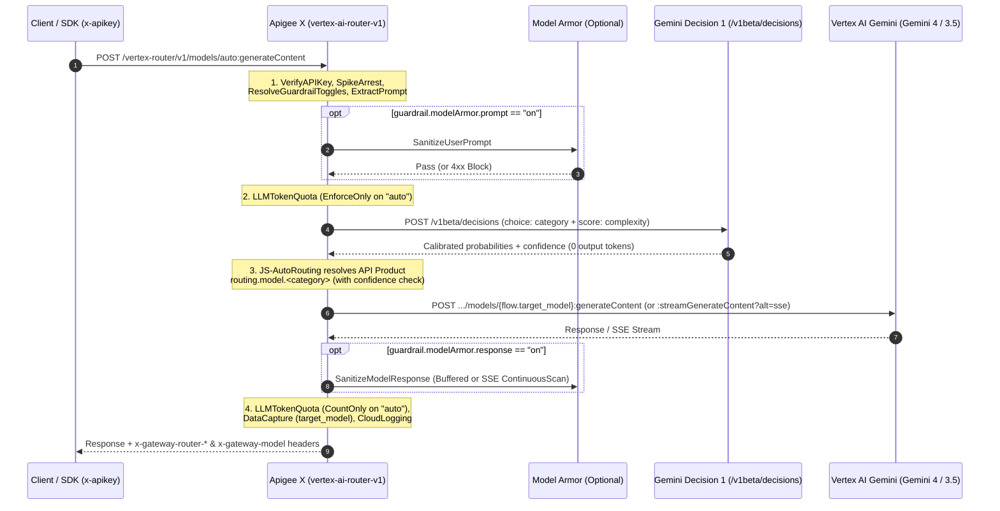

# Vertex AI Gemini Gateway with Gemini Decision 1 Auto-Routing

An enterprise **Apigee X AI Gateway** example built directly on the **`vertex-ai-v1`** governance base and extended with **zero-output-token intelligent auto-routing** powered by **Google Gemini Decision 1 (`gemini-decision-1`)**.

Callers send prompts to a single `/models/auto:generateContent` or `/models/auto:streamGenerateContent?alt=sse` endpoint. In a single prefill pass (`0` output tokens), **Gemini Decision 1** (`POST https://generativelanguage.googleapis.com/v1beta/decisions`) evaluates both a calibrated **routing category** (`choice`) and **reasoning complexity** (`score`), and Apigee maps that decision to the optimal **Gemini 4** model configured on the caller's **API Product**.

---

## Plain-English Protection & Routing Summary

| Capability | What It Solves | Apigee Policies Behind the Scenes |
|---|---|---|
| **Single gateway key (zero GCP credentials on clients)** | Apps & IDEs authenticate with a revocable Apigee key while Apigee signs into Gemini Decision 1 & Vertex AI via IAM | `EV-ExtractAPIKey` + `VA-VerifyAPIKey` + `AM-RemoveAuthorization` + `<GoogleAccessToken>` |
| **Zero-output-token smart routing (`/models/auto`)** | Routes greetings/lookups to cheap Flash-Lite, everyday chat to Hydrogen, coding to Argon, and hard reasoning/proofs to Carbon | `AM-PrepRouterRequest` + `SC-ModelRouter` (`gemini-decision-1`) + `JS-AutoRouting` |
| **Per-team model tiers without proxy redeployments** | Engineering & Support can call the exact same `/models/auto` endpoint and land on different model tiers based on their API key | API Product custom attributes (`routing.model.<category>`, `routing.confidence.min`) |
| **Traffic spike & token budget enforcement** | Stops runaway client loops before calling either the router or Vertex AI, and counts tokens across buffered & SSE streams | `SA-SpikeArrest` + `LTQ-TokenEnforce` / `LTQ-TokenCount` / `LTQ-TokenCountSSE` |
| **Toggleable prompt & streaming response guardrails** | Screens prompts for jailbreaks/injection and scans live SSE chunks via Google Cloud Model Armor (toggleable per API Product) | `AM-ResolveGuardrailToggles` + `SUP-UserPrompt` + `SMR-SanitizeModelResponse` + `SMR-SanitizeModelResponseSSE` (`<ContinuousScan>`) |
| **Buffered & live SSE streaming parity** | Dedicated buffered and 300s SSE streaming targets prevent buffering delays while capturing unified analytics & Cloud Logs | `gemini-vertex-target` + `gemini-vertex-stream-target` (`<EventFlow>`) + `DC-ModelAnalytics` + `ML-CloudLogging` |

---

## Architecture & Request Lifecycle



---

## Why Gemini Decision 1 (`gemini-decision-1`) for Gateway Routing?

Traditional LLM routers call `:generateContent` with a JSON schema, paying output token latency and risking malformed/truncated JSON. **Gemini Decision 1** is purpose-built for closed-ended routing and scoring:

1. **Zero output tokens (`total_output_tokens: 0`)**: Evaluates all questions in a single prefill pass.
2. **Parallel multi-question scoring**: `AM-PrepRouterRequest.xml` evaluates both `category` (`choice`) and `complexity` (`score`, 0–3 rubric) simultaneously in one request with flat latency.
3. **Calibrated probabilities & confidence gating**: Returns `confidence` (`0.0`–`1.0`). When confidence falls below the API Product's `routing.confidence.min` (default `0.55`), `AutoRouting.js` safely routes to `routing.model.general`.
4. **Keyless GCP IAM authentication**: `SC-ModelRouter.xml` calls `https://generativelanguage.googleapis.com/v1beta/decisions` using Apigee's native `<GoogleAccessToken>` (`generative-language` + `cloud-platform` scopes) — no API keys or KVMs to rotate.

### Persona API Product Routing Matrix

Both API Products ship in [`products/`](products/) and work against the exact same proxy revision:

| Router Category (`choice`) | `vertex-router-engineering` (`engineering_tier.json`) | `vertex-router-support` (`support_tier.json`) |
|---|---|---|
| **`coding`** | `gemini-4-argon` | `gemini-4-hydrogen` |
| **`deep_reasoning`** | `gemini-4-carbon` | `gemini-4-argon` |
| **`general`** | `gemini-4-hydrogen` | `gemini-3.5-flash-lite` |
| **`simple`** | `gemini-3.5-flash-lite` | `gemini-3.5-flash-lite` |

---

## Quickstart

### 1. Offline Validation & Unit Tests (No GCP Account Required)

From the repository root:

```bash
make all
```

Or directly inside this example directory:

```bash
python3 ../../scripts/validate_bundle.py . --strict
node --test tests/autorouting.test.mjs
```

### 2. Deploy to an Existing Apigee X Organization

```bash
cp .env.example .env
# Edit .env with APIGEE_ORG, APIGEE_ENV, APIGEE_HOST, and GCP_PROJECT_ID

chmod +x scripts/*.sh
./scripts/deploy.sh
```

> **Want Model Armor enabled too?** Pass `--create-armor-templates` on first deploy to provision `apigee-sanitize-user-prompt` and `apigee-sanitize-model-response` in `GCP_REGION` and set `guardrail.modelArmor.* = "on"` on both API Products:
> ```bash
> ./scripts/deploy.sh --create-armor-templates
> ```

### 3. Test Auto-Routing & Direct Calls

```bash
# Auto-routed coding prompt (Engineering key -> gemini-4-argon)
curl -si -X POST "https://${APIGEE_HOST}/vertex-router/v1/models/auto:generateContent" \
  -H "Content-Type: application/json" \
  -H "x-apikey: ${ENG_API_KEY}" \
  -d '{
    "contents": [
      {"role": "user", "parts": [{"text": "Write a Python binary search function with type annotations."}]}
    ]
  }' | grep -iE "^(HTTP/|x-auto-routed|x-gateway-)"
```

Sample response headers:

```http
HTTP/2 200
x-gateway-model: gemini-4-argon
x-auto-routed: true
x-gateway-routing-tier: vertex-router-engineering
x-gateway-router-engine: gemini-decision-1
x-gateway-router-category: coding
x-gateway-router-confidence: 0.98
x-gateway-router-complexity: 1.92
x-gateway-router-input-tokens: 214
x-gateway-router-output-tokens: 0
x-gateway-guardrails: armor-prompt=off;armor-response=off
x-gateway-prompt-tokens: 18
x-gateway-candidates-tokens: 164
x-gateway-total-tokens: 182
```

```bash
# Auto-routed SSE streaming (:streamGenerateContent?alt=sse)
curl -N -sS -X POST "https://${APIGEE_HOST}/vertex-router/v1/models/auto:streamGenerateContent?alt=sse" \
  -H "Content-Type: application/json" \
  -H "x-apikey: ${ENG_API_KEY}" \
  -d '{
    "contents": [
      {"role": "user", "parts": [{"text": "Explain consensus algorithms in 3 bullet points."}]}
    ]
  }'

# Direct model call (bypasses Gemini Decision 1 router, keeps full governance)
curl -sS -X POST "https://${APIGEE_HOST}/vertex-router/v1/models/gemini-4-hydrogen:generateContent" \
  -H "Content-Type: application/json" \
  -H "x-apikey: ${ENG_API_KEY}" \
  -d '{
    "contents": [
      {"role": "user", "parts": [{"text": "Summarize Apigee AI Gateway in one sentence."}]}
    ]
  }'
```

### 4. Run the Automated Live Verification Suite

```bash
APIGEE_HOST="${APIGEE_HOST}" ENG_API_KEY="${ENG_API_KEY}" SUP_API_KEY="${SUP_API_KEY}" ./scripts/verify.sh
```

### 5. Optional: Python Rubric Playground (`google-genai >= 3.5.0`)

Test and tune the `gemini-decision-1` routing rubric directly from Python (or compare Engineering vs Support gateway routing):

```bash
pip install -U "google-genai>=3.5.0"

# Test Gemini Decision 1 probabilities locally
GEMINI_API_KEY="..." python3 client/python_example.py --local-decisions

# Compare persona routing against the deployed Apigee gateway
APIGEE_HOST="${APIGEE_HOST}" ENG_API_KEY="${ENG_API_KEY}" SUP_API_KEY="${SUP_API_KEY}" \
  python3 client/python_example.py --gateway
```

### 6. Cleanup

```bash
./scripts/cleanup.sh
```
