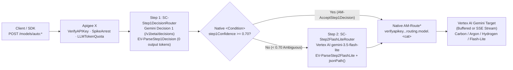

# Vertex AI Gemini Gateway with 2-Step Cascaded Decision Routing

An **Apigee X AI Gateway** example built on the **`vertex-ai-v1`** base implementing a **100% native XML two-step confidence-cascaded model router** (zero JavaScript in `AutoRoutingFlow`):

1. **Step 1 — Ultra-Fast Calibrated Prefill (`gemini-decision-1`, `0` output tokens)**: Evaluates every `/models/auto` prompt in a single forward pass via the Gemini Decisions API (`POST /v1beta/decisions`). `EV-ParseStep1Decision` extracts `choice` and `confidence`, and a native Apigee `<Condition>` (`flow.step1Confidence >= 0.70`) accepts high-confidence classifications immediately.
2. **Step 2 — Ambiguity Tie-Breaker (`gemini-3.5-flash-lite` on Vertex AI, `< 70%` confidence)**: Only when `flow.step1Accepted != "true"` (ambiguous prompt `< 0.70` or Step 1 unavailable), `AM-PrepStep2FlashLite` and `SC-Step2FlashLiteRouter` invoke `gemini-3.5-flash-lite:generateContent` with Step 1's calibrated probability split embedded as prior context, and `AM-AcceptStep2Decision` extracts the category via `{jsonPath('$.category',flow.step2RawJson)}`.

---

## Native Apigee Policies vs. JavaScript Design Review

Following Apigee X best practices (*prefer built-in XML policies over script callouts*), **all routing, JSON extraction, confidence gating, and API Product model resolution use native policies**:

| Responsibility | Implementation | Why Native / Why JS? |
|---|---|---|
| **Step 1 JSON extraction** | `EV-ParseStep1Decision` (`ExtractVariables`) | Native JSONPath (`$.answers.category.choice`, `$.answers.category.confidence`, `$.answers.category.probabilities.*`) — faster & visible in Apigee Trace |
| **70% Confidence gate** | Native `<Condition>` (`flow.step1Confidence >= 0.70`) | Built-in Apigee numeric comparison skips Step 2 policies declaratively |
| **Step 2 JSON request build** | `AM-PrepStep2FlashLite` (`AssignMessage`) | Native message templates (`{escapeJSON(flow.routerInput)}`, `{flow.probCoding:0}`) build the Vertex AI payload with zero JS |
| **Step 2 JSON extraction** | `EV-ParseStep2FlashLite` + `{jsonPath('$.category',flow.step2RawJson)}` | Native `ExtractVariables` + `AssignMessage` template function |
| **Persona model lookup** | `AM-InitAutoRouting` + `AM-RouteCoding` / `AM-RouteDeepReasoning` / `AM-RouteSimple` | Native `<AssignVariable><Ref>` binds `verifyapikey.VA-VerifyAPIKey.apiproduct.routing.model.*` directly |
| **Multi-turn prompt windowing** | `JS-ExtractPromptAndModel` *(from `vertex-ai-v1`)* | Retained in JS: joins `systemInstruction` + multi-turn `contents[*].parts[*]`, filters out `thought: true` blocks, and safely windows >8,000-char prompts (head + tail) |
| **SSE chunk completion** | `JS-ProcessStreamEvent` *(from `vertex-ai-v1`)* | Mandatory JS: Apigee X `<EventFlow>` forbids `ExtractVariables` and `AssignMessage` |

---

## Architecture & 2-Step Routing Flow



---

## Persona API Product Routing Matrix

Both API Products ship in [`products/`](products/) and work against the exact same proxy revision:

| Final Category | `vertex-two-step-engineering` (`engineering_tier.json`) | `vertex-two-step-support` (`support_tier.json`) |
|---|---|---|
| **`coding`** | `gemini-4-argon` | `gemini-4-hydrogen` |
| **`deep_reasoning`** | `gemini-4-carbon` | `gemini-4-argon` |
| **`general`** | `gemini-4-hydrogen` | `gemini-3.5-flash-lite` |
| **`simple`** | `gemini-3.5-flash-lite` | `gemini-3.5-flash-lite` |

> **Deterministic Step 2 testing:** Pass `-H "x-force-step2: true"` on any `/models/auto` request in evals or integration tests to bypass `AM-AcceptStep1Decision` and exercise the live Step 2 `gemini-3.5-flash-lite` disambiguation path.

---

## Observability Headers Returned on Every Call

```http
# Fast-Path Response (Step 1 >= 70% confidence — Step 2 skipped)
x-gateway-model: gemini-4-argon
x-auto-routed: true
x-gateway-routing-tier: vertex-two-step-engineering
x-gateway-router-step: step1-decision-1
x-gateway-router-engine: gemini-decision-1
x-gateway-router-category: coding
x-gateway-router-threshold: 0.70
x-gateway-router-step1-category: coding
x-gateway-router-step1-confidence: 0.97
x-gateway-router-complexity: 1.94
x-gateway-router-step1-tokens: 214
x-gateway-router-step2-tokens: 0
```

```http
# Escalated Response (Step 1 < 70% confidence -> Step 2 Gemini 3.5 Flash-Lite)
x-gateway-model: gemini-4-argon
x-auto-routed: true
x-gateway-routing-tier: vertex-two-step-engineering
x-gateway-router-step: step2-flash-lite
x-gateway-router-engine: gemini-3.5-flash-lite
x-gateway-router-category: coding
x-gateway-router-threshold: 0.70
x-gateway-router-step1-category: general
x-gateway-router-step1-confidence: 0.54
x-gateway-router-complexity: 1.48
x-gateway-router-step1-tokens: 229
x-gateway-router-step2-tokens: 186
```

---

## Quickstart

### 1. Offline Validation & Unit Tests (No GCP Account Required)

From the repository root:

```bash
make all
```

### 2. Deploy to an Existing Apigee X Organization

```bash
cp .env.example .env
# Edit .env with APIGEE_ORG, APIGEE_ENV, APIGEE_HOST, and GCP_PROJECT_ID

./scripts/deploy.sh
```

### 3. Run the Live Verification Suite (Tests Step 1, Step 2 Escalation & SSE)

```bash
APIGEE_HOST="${APIGEE_HOST}" ENG_API_KEY="${ENG_API_KEY}" SUP_API_KEY="${SUP_API_KEY}" ./scripts/verify.sh
```

### 4. Optional: Python 2-Step Playground (`google-genai >= 3.5.0`)

```bash
pip install -U "google-genai>=3.5.0"

# Run the exact 2-step cascade locally against the Gemini API
GEMINI_API_KEY="..." python3 client/python_example.py --local-two-step

# Test against the deployed Apigee 2-step gateway
APIGEE_HOST="${APIGEE_HOST}" ENG_API_KEY="${ENG_API_KEY}" SUP_API_KEY="${SUP_API_KEY}" \
  python3 client/python_example.py --gateway
```

### 5. Cleanup

```bash
./scripts/cleanup.sh
```
