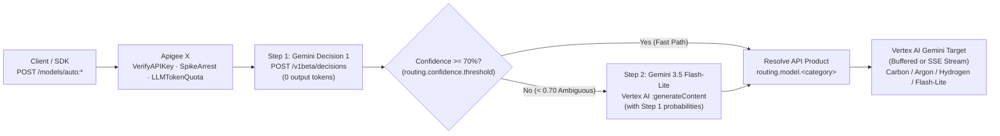

# Vertex AI Gemini Gateway with 2-Step Cascaded Decision Routing

An **Apigee X AI Gateway** example built on the **`vertex-ai-v1`** base implementing a **two-step confidence-cascaded model router**:

1. **Step 1 — Ultra-Fast Calibrated Prefill (`gemini-decision-1`, `0` output tokens)**: Evaluates every `/models/auto` prompt in a single forward pass via the Gemini Decisions API (`POST /v1beta/decisions`). When **confidence is `>= 70%` (`0.70`)**, Apigee routes immediately with zero generative router overhead.
2. **Step 2 — Ambiguity Tie-Breaker (`gemini-3.5-flash-lite` on Vertex AI, `< 70%` confidence)**: Only when a prompt is ambiguous (`confidence < 0.70`) or Step 1 is unavailable, Apigee invokes `gemini-3.5-flash-lite` with structured JSON output — passing **Step 1's calibrated probability distribution as prior context** — to make the final routing decision.

---

## Architecture & 2-Step Routing Flow



### Why a 2-Step Confidence Cascade?

| Traffic Segment | Router Executed | Output Tokens Paid | Why It Wins |
|---|---|---|---|
| **Clear prompts (~85–90% of traffic)** — e.g. *"Write a Python quicksort"*, *"Hi!"*, *"Prove consensus safety under WAN partitions"* | **Step 1 only** (`gemini-decision-1`) | **`0` tokens** | Single prefill pass, lowest latency, calibrated probability `>= 0.70` |
| **Ambiguous / multi-intent prompts (~10–15% of traffic)** — e.g. *"Draft a short note explaining why our SQL index slowed down writes and include a 3-line snippet"* | **Step 1 → Step 2** (`gemini-3.5-flash-lite`) | **~6 JSON tokens** | Step 2 reasons over user intent + Step 1's probability split (`coding` vs `general` vs `deep_reasoning`) instead of guessing blindly |
| **Step 1 outage / timeout** | **Step 2 automatic failover** (`gemini-3.5-flash-lite`) | **~6 JSON tokens** | Built-in high availability across `generativelanguage.googleapis.com` and `aiplatform.googleapis.com` |

---

## Persona API Product Routing Matrix

Both API Products ship in [`products/`](products/) with `routing.confidence.threshold = "0.70"`:

| Final Category | `vertex-two-step-engineering` (`engineering_tier.json`) | `vertex-two-step-support` (`support_tier.json`) |
|---|---|---|
| **`coding`** | `gemini-4-argon` | `gemini-4-hydrogen` |
| **`deep_reasoning`** | `gemini-4-carbon` | `gemini-4-argon` |
| **`general`** | `gemini-4-hydrogen` | `gemini-3.5-flash-lite` |
| **`simple`** | `gemini-3.5-flash-lite` | `gemini-3.5-flash-lite` |

> **Per-request stricter threshold (for evals & testing):** Callers can pass `x-router-confidence-threshold: 0.90` (or `1.00` in integration tests to deterministically exercise Step 2). For safety, the proxy only allows the header to **raise** strictness above the API Product's `0.70` floor, never lower it.

---

## Observability Headers Returned on Every Call

```http
# Fast-Path Response (Step 1 >= 70% confidence — Step 2 skipped)
x-gateway-model: gemini-4-argon
x-auto-routed: true
x-gateway-routing-tier: vertex-two-step-engineering
x-gateway-router-step: step1-decision-1
x-gateway-router-engine: gemini-decision-1
x-gateway-router-category: coding
x-gateway-router-threshold: 0.70
x-gateway-router-step1-category: coding
x-gateway-router-step1-confidence: 0.97
x-gateway-router-complexity: 1.94
x-gateway-router-step1-tokens: 214
x-gateway-router-step2-tokens: 0
```

```http
# Escalated Response (Step 1 < 70% confidence -> Step 2 Gemini 3.5 Flash-Lite)
x-gateway-model: gemini-4-argon
x-auto-routed: true
x-gateway-routing-tier: vertex-two-step-engineering
x-gateway-router-step: step2-flash-lite
x-gateway-router-engine: gemini-3.5-flash-lite
x-gateway-router-category: coding
x-gateway-router-threshold: 0.70
x-gateway-router-step1-category: general
x-gateway-router-step1-confidence: 0.54
x-gateway-router-complexity: 1.48
x-gateway-router-step1-tokens: 229
x-gateway-router-step2-tokens: 186
```

---

## Quickstart

### 1. Offline Validation & Unit Tests (No GCP Account Required)

From the repository root:

```bash
make all
```

Or directly inside this example directory:

```bash
python3 ../../scripts/validate_bundle.py . --strict
node --test tests/two_step_routing.test.mjs
```

### 2. Deploy to an Existing Apigee X Organization

```bash
cp .env.example .env
# Edit .env with APIGEE_ORG, APIGEE_ENV, APIGEE_HOST, and GCP_PROJECT_ID

./scripts/deploy.sh
```

### 3. Run the Live Verification Suite (Tests Step 1, Step 2 Escalation & SSE)

```bash
APIGEE_HOST="${APIGEE_HOST}" ENG_API_KEY="${ENG_API_KEY}" SUP_API_KEY="${SUP_API_KEY}" ./scripts/verify.sh
```

### 4. Optional: Python 2-Step Playground (`google-genai >= 3.5.0`)

```bash
pip install -U "google-genai>=3.5.0"

# Run the exact 2-step cascade locally against the Gemini API
GEMINI_API_KEY="..." python3 client/python_example.py --local-two-step

# Test against the deployed Apigee 2-step gateway
APIGEE_HOST="${APIGEE_HOST}" ENG_API_KEY="${ENG_API_KEY}" SUP_API_KEY="${SUP_API_KEY}" \
  python3 client/python_example.py --gateway
```

### 5. Cleanup

```bash
./scripts/cleanup.sh
```
